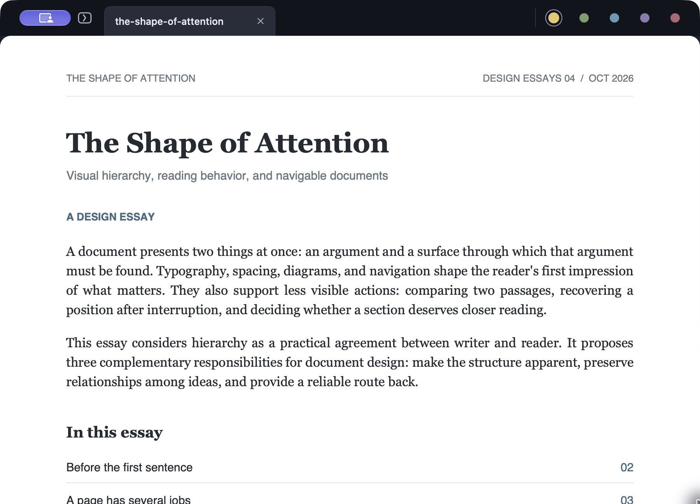
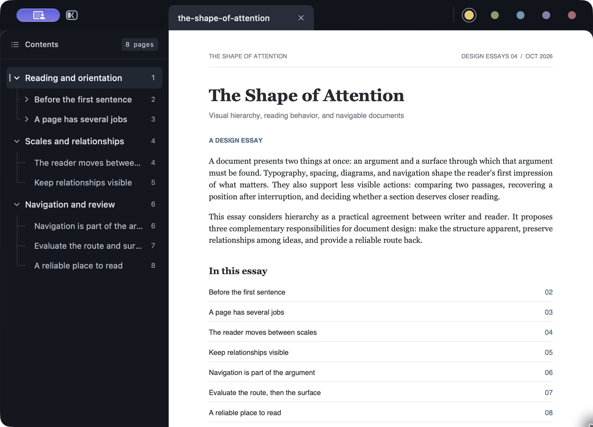
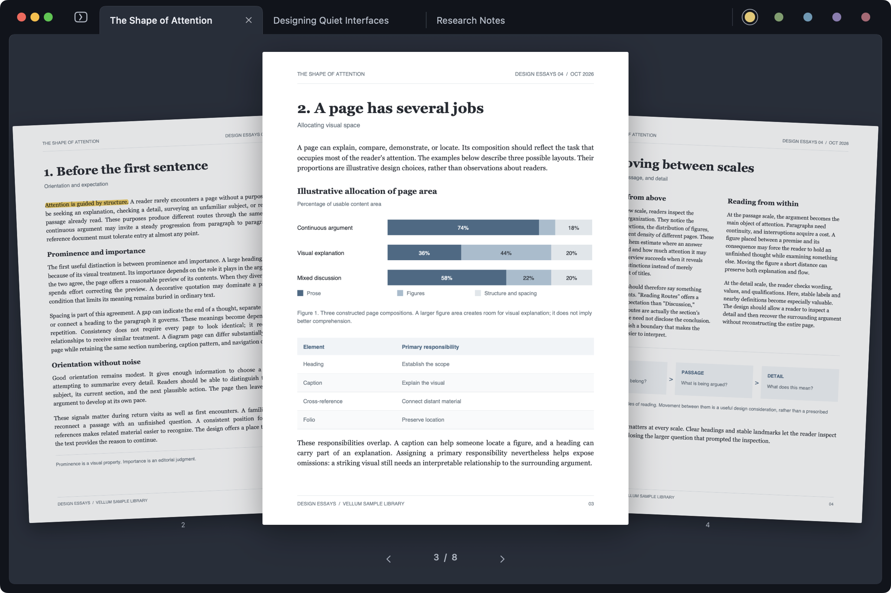
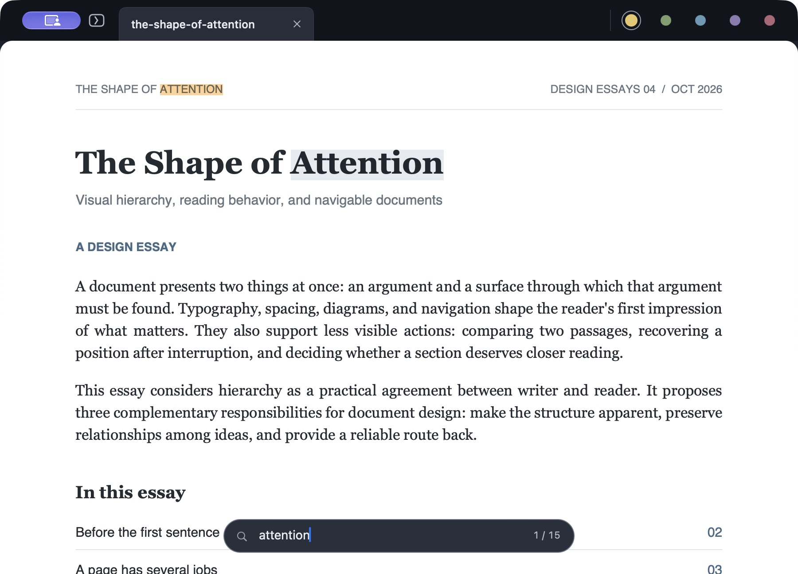
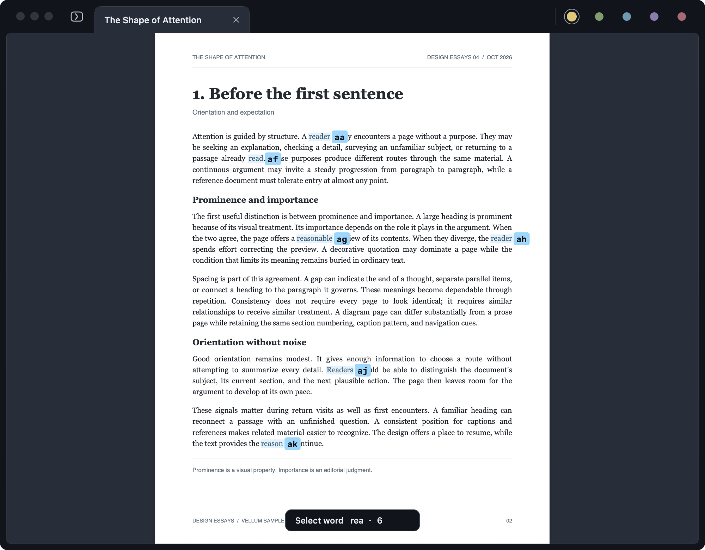

# Vellum

English | [简体中文](README.zh-CN.md)

**A native macOS PDF reader for staying with the page.**

Vellum brings smooth Vim-style navigation, a keyboard-driven outline, and an immersive page gallery to a quiet, compact reading interface. Built with SwiftUI, AppKit, and PDFKit.

[Download for macOS](https://github.com/AbyssSkb/Vellum/releases/latest) · [User guide](docs/USER_GUIDE.md) · [Report an issue](https://github.com/AbyssSkb/Vellum/issues)



## Read at your own pace

Tap or hold `j` and `k` to scroll smoothly. Fit the page or its width, zoom continuously, jump to a page with `12G`, and retrace your reading with `Control-O` and `Control-I`. Select text with the mouse, then refine the selection by line or word from the keyboard.

Use counts such as `5f` to move five pages, `3n` to advance three search matches, or `3w` to extend a selection by three word motions. Press `F` to label visible PDF links, then type a label to follow it.

Press `p`, then type a visible internal link's label to open and focus its floating preview without leaving your reading position. The preview grows or shrinks within the available reader width and height, preserving content proportions inside a thin frame. It has rounded inner corners and no toolbar. Scroll it with `j` / `k`, use `=` / `+` / `-` to zoom, press `p` again or `Enter` to close the preview and visit its target, or `x` / `Esc` to close it at the same reading position. `Control-O` returns after a jump. Internal links can preview a figure with adjacent panels, nearby detached legends, and its caption, a table with its caption, notes, and complete borders, a framed algorithm with its title and input conditions, a numbered equation or equation group, a complete bibliography entry, a section heading with its opening paragraph, or the text paragraph at the destination. Isolated regions fill the preview; bibliography entries and section openings can continue across two adjacent pages. Other links, scanned pages, and targets without reliable crop boundaries use page context near their destination.

Keep several documents close with compact tabs. `T` opens a searchable file list with a preview of each document's last-read page; press `Enter` to resume reading the selected file. `X` restores the last closed file. Each file has one tab; reopening an updated PDF reloads its current contents. Long tab titles scroll once when opened, activated, or hovered.

Press `Z` (`Shift-Z`) to find and open a PDF in your home folder (`~/`) by filename or path. Quick Open uses Spotlight's indexed `.pdf` files, including `.PDF`, and an installed [fzf](https://github.com/junegunn/fzf) for fuzzy matching. New downloads may take time to appear, and Spotlight exclusions and file permissions apply. See the [setup and controls](docs/USER_GUIDE.md#quick-open-a-pdf).

## A map when you need one

Press `t` to show or hide the contents sidebar. Tap `Tab` to move keyboard focus between the page and outline, opening the sidebar if needed. Browse with `j` and `k`, fold with `h`, and expand with `l`. Press `Enter` to jump and resume reading. The outline also supports Vim's `zo`, `zc`, `zO`, `zC`, `zr`, `zm`, `zR`, and `zM`, including recursive folds and count prefixes. `H` and `L` switch documents while the outline stays open.



## See the pages around you

Hold `Tab` to enter the immersive gallery, with a large current-page preview between its neighbors. Use `h` / `l` to move one page or `k` / `j` to move three pages. Release `Tab` to read the selected page, or press `Esc` to return to where you started.



## Keep the useful parts

Search with `/`, or press `*` to search selected text immediately. Move through matches with `n` and `N`, and press `v` to select a match. Copy with `y` or highlight with `m`; five highlight colors are available. Annotations save back to the PDF automatically, with recovery options if the file cannot be saved or has changed on disk.

Revisit highlights with `gn` / `gN`, or use `M` to search highlighted text and page numbers. Press `Enter` to return to a passage, ready to copy, explain, or delete its highlight.



Press `s`, type the beginning of a visible word, then type its letter label to select the whole word. Refine the selection with Vim motions; a thin caret marks the endpoint being adjusted, and `o` switches to the other end. Use `^` / `$` to reach the first text / end of the visual line. Copy with `y` or highlight with `m`, then use `gv` to restore the last selection. Labels adapt to the displayed text size and stay in place as you enter a multi-letter label.



*Screenshots use this [sample PDF](docs/samples/the-shape-of-attention.pdf).*

## Look up words offline

Select a word and press `K` (`Shift-K`), or set double-clicks to **Dictionary** in General settings. Vellum displays entries from a local MDict dictionary with their original formatting, images, and pronunciation recordings. Vellum starts with no dictionary included or selected. Choose your `.mdx` file in **Settings → General**; see the [dictionary setup](docs/USER_GUIDE.md#local-dictionaries) for supported files and controls.

## Experimental AI

AI assistance is optional and experimental. See the [user guide](docs/USER_GUIDE.md#experimental-ai) for configuration and usage.

## Get started

1. Download the latest DMG from [Releases](https://github.com/AbyssSkb/Vellum/releases/latest), then drag Vellum into Applications.
2. Open a PDF with `Command-O`, or `o` when no text is selected. Use `O` to open files in new tabs.
3. Press `z` to fit the width or `0` to fit the whole page, then move with `j` and `k`.

| Key | Action |
| --- | --- |
| `j` / `k`, `d` / `u` | Scroll down / up; larger steps with `d` / `u` |
| `Space` / `f`, `b` | Next / previous page |
| `gg`, `G`, `12G` / `12gg` | First page, last page, page 12 |
| `=` / `-`, `0`, `z` | Zoom in / out, fit page, fit width |
| `t` | Show / hide the contents sidebar |
| Tap `Tab` | Switch focus between the reader and contents |
| Hold `Tab` | Open the page gallery |
| `H` / `L`, `T` | Previous / next tab; searchable tab switcher |
| `Z` (`Shift-Z`) | Fuzzy search indexed PDF filenames and paths in your home folder |
| `/` / `*`, `n` / `N` | Search a query / selected text; next / previous match |
| `s` | Type a visible word prefix and its label to select |
| `K` (`Shift-K`) | Look up the selected word in a local dictionary |
| `o` with text selected | Switch the endpoint adjusted by selection motions |
| `^` / `$` with text selected | First text / end of visual line |
| `gv` | Restore the last text selection |
| `F` | Label and follow visible PDF links |
| `p` | Label and preview visible internal PDF links; press again to jump |
| `m`, `c`, `y` | Highlight, change highlight color, copy |
| `M`, `gn` / `gN` | Search highlights; next / previous highlight |

Letter shortcuts apply to the focused reading surface. The [user guide](docs/USER_GUIDE.md) covers selection, outline folds, focus behavior, and the full shortcut set.

## Preferences and updates

Settings include English and Chinese UI, default file-opening behavior, initial page fit, highlight color, local dictionaries, optional session restoration, and AI configuration. Session restoration is off by default.

Sparkle handles automatic updates, with checks enabled by default. A new version downloads and prepares in the background, then Vellum offers to restart and update now or install when you normally quit. Manual checks from the Vellum menu or General settings use the same update window, with Vim-style release-note scrolling and letter shortcuts shown on its buttons. See the [update controls](docs/USER_GUIDE.md#settings-and-updates).

## Build from source

Requires macOS 15 or later and a Swift 6.2 toolchain. Release downloads support Apple silicon and Intel Macs.

```sh
git clone https://github.com/AbyssSkb/Vellum.git
cd Vellum
scripts/test.sh
scripts/package-app.sh
open dist/Vellum.app
```

The packaging script builds a universal macOS app in `dist/Vellum.app`.

## Feedback

Report bugs or suggest improvements through [GitHub Issues](https://github.com/AbyssSkb/Vellum/issues). For rendering or navigation problems, include the macOS version, steps to reproduce, and a sample PDF you can share.
